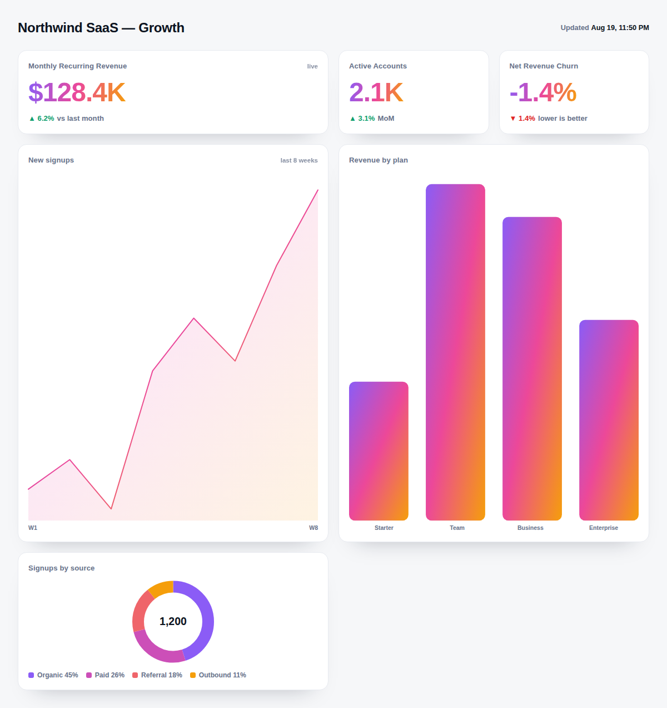

# API Dashboard Builder

Turn the APIs you already have into a clean, live dashboard, without a 20-question intake.
A [Claude Code](https://claude.ai/code) skill that reads your endpoints, recommends what's
worth measuring, picks the right chart for each metric, and ships a single self-contained
HTML file that pulls the numbers live.



*Every chart above is drawn with inline SVG. No libraries, no CDN, one file. The gradient is optional and set from your brand colors.*

## What it does

- **Asks the fewest questions it can.** It looks at what your endpoints actually return,
  proposes 5-9 metrics worth watching, and confirms with one question instead of an
  interrogation.
- **Picks the right chart.** Big number, bar, line, or donut, chosen from the question each
  metric answers, not from what looks flashy.
- **Builds a real, live dashboard.** A single HTML file that fetches your endpoints, formats
  the numbers, stamps a last-updated time, and works on desktop and mobile.
- **Wears your brand.** Optional: hand it a hex color and a logo, or a full brand gradient,
  and the whole thing themes to match.

## Install

Clone into your skills directory:

```bash
# user-level (available in every project)
git clone https://github.com/brittanyslay/api-dashboard-builder.git ~/.claude/skills/api-dashboard-builder

# or per-project
git clone https://github.com/brittanyslay/api-dashboard-builder.git /path/to/project/.claude/skills/api-dashboard-builder
```

Then just ask: *"Build me a dashboard from these APIs,"* and paste your endpoints (or an
OpenAPI spec). Claude picks the skill up from there.

## What's inside

| File | What it's for |
|---|---|
| `SKILL.md` | The workflow Claude follows: intake, metric selection, chart mapping, build, test. |
| `references/dashboard-template.html` | The zero-dependency engine Claude fills in. Inline-SVG charts, theming, live fetch. |
| `references/intake.md` | Collect little, infer a lot. The one-question intake. |
| `references/chart-selection.md` | Which chart answers which question. |
| `references/metric-frameworks.md` | The 5-9 rule, leading vs. lagging, F-pattern layout. |
| `references/example-run.md` | A full worked example, start to finish. |
| `examples/example-dashboard.html` | The rendered dashboard from the screenshot. Open it in a browser. |

## Try the example

Open `examples/example-dashboard.html` in any browser. It renders with inline sample data,
so it works offline and shows exactly what the skill produces.

---

Built by [Brittany Slay](https://brittanyslay.com), a B2B marketing leader who builds
AI-native tools. More free Claude skills at [brittanyslay.com/skills](https://brittanyslay.com/skills).
Free to use, copy, and share (MIT). If you want a dashboard, a GTM build, or an AI-native
marketing function built for real, [get in touch](https://brittanyslay.com/#contact).
